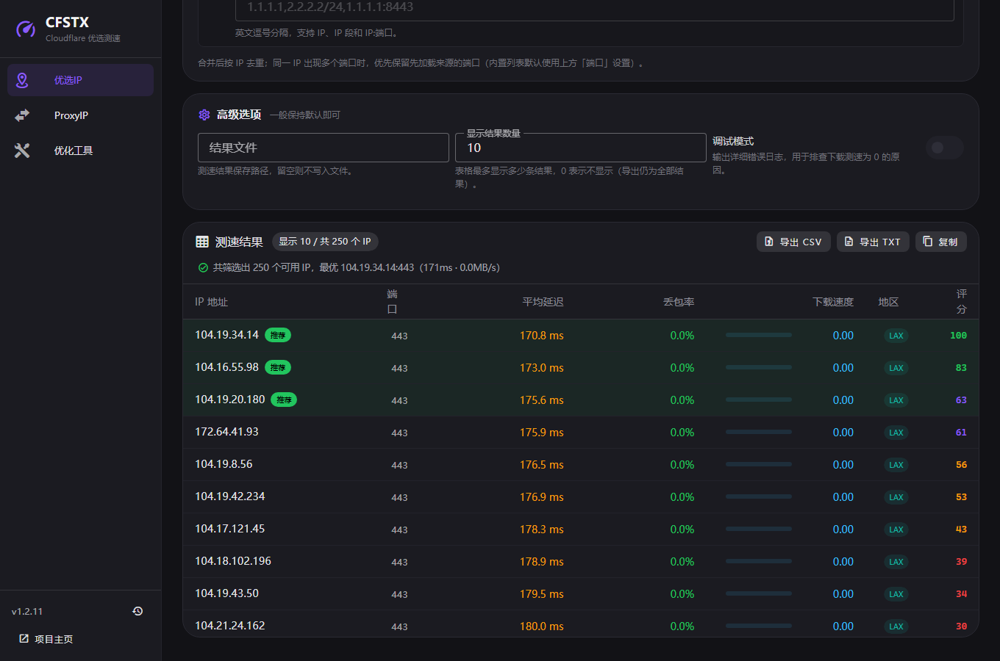
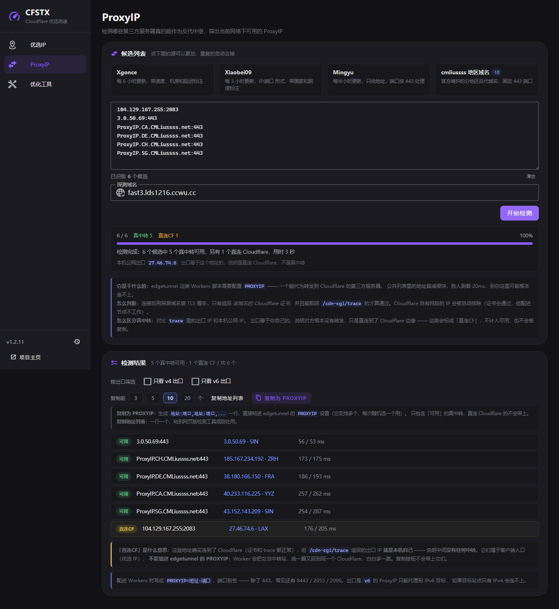

# CFSTX

> **Cloudflare CDN 优选 IP 测速工具** · Windows 桌面端
>
> 基于 [XIU2/CloudflareSpeedTest](https://github.com/XIU2/CloudflareSpeedTest) 二次开发　·　许可证 [GPL-3.0](LICENSE)



---

## 它解决什么问题

国外大量网站在使用 Cloudflare CDN，但分配给中国大陆访客的 IP 往往延迟高、丢包多。Cloudflare 公开了全部 [IP 段](https://www.cloudflare.com/zh-cn/ips/)，但从几万个地址里手工挑出适合自己的，不现实。

CFSTX 把这件事自动化：**批量测速 → 按你的条件过滤 → 给出可直接填进客户端的结果**。

而在实际使用中，还有两个坑是单纯测速解决不了的：

| 坑 | 表现 | CFSTX 的解法 |
|---|---|---|
| **测速通过，客户端全 timeout** | 通用测速地址能连，你的 Worker 域名连不上 | **自定义测速域名探测** |
| **edgetunnel 节点连不上** | 缺可用的 `PROXYIP` 中继 | **ProxyIP 优选** |

---

## 能做什么

| 能力 | 一句话说明 | 详解 |
|---|---|---|
| **七种 IP 来源** | 内置列表、官方网段、社区列表、自建源可任意组合，去重后最多 1.3 万目标 | [优选IP](https://gitee.com/liliaic/cfstx/wiki/Speed-Test) |
| **自定义测速域名** | 只保留真正服务你 Worker / Pages 域名的 IP | [优选IP](https://gitee.com/liliaic/cfstx/wiki/Speed-Test) |
| **ProxyIP 优选** | 检测哪些第三方服务器真的能作反代中继，并区分「真中转」与「直连入口」 | [ProxyIP](https://gitee.com/liliaic/cfstx/wiki/ProxyIP) |
| **综合评分** | 速度 + 延迟 + 丢包加权，前 3 名标「推荐」 | [优选IP](https://gitee.com/liliaic/cfstx/wiki/Speed-Test) |
| **一键复制** | 纯 IP / `IP:端口` / `IP:端口#地区` / `PROXYIP` 格式 | [优选IP](https://gitee.com/liliaic/cfstx/wiki/Speed-Test) |
| **Hosts 加速** | 把优选 IP 写进 hosts，浏览器直连也走最快节点 | [优化工具](https://gitee.com/liliaic/cfstx/wiki/Optimize-Tools) |
| **订阅优化指引** | 自动生成 DIRECT 规则，打破「更新订阅走代理 → 节点失效」的死循环 | [优化工具](https://gitee.com/liliaic/cfstx/wiki/Optimize-Tools) |
| **命令行模式** | 同一个 exe，带参数即 CLI，可接入脚本 | [命令行手册](https://gitee.com/liliaic/cfstx/wiki/CLI) |
| **应用内更新** | 检测 → 下载 → 拉起安装 | [常见问题](https://gitee.com/liliaic/cfstx/wiki/FAQ) |

> [!IMPORTANT]
> Cloudflare CDN 已**明文禁止代理**方式使用，通过代理套 CDN 的请自行承担风险，请勿过度依赖。

---

## 下载

前往 [**Releases**](https://gitee.com/liliaic/cfstx/releases) 下载最新版：

| 版本 | 文件 | 说明 |
|---|---|---|
| **安装版（推荐）** | `CFSTX-Setup-x.x.x.exe` | 标准安装向导，自动创建快捷方式，支持应用内更新 |
| 免安装版 | `CFSTX-x.x.x-portable.zip` | 解压即用，不写注册表 |

> [!NOTE]
> 暂未购买代码签名证书，首次运行安装包时 Windows SmartScreen 可能提示「**无法验证发布者**」。
> 点击「**更多信息**」→「**仍要运行**」即可。

**系统要求**：Windows 10 / 11（x64）。需要 WebView2 运行时（Win11 自带，Win10 若缺少会提示安装）。

---

## 快速开始

1. **双击 `cfstx.exe`** —— 不带参数即进入图形界面
2. **左侧选页面** —— 优选IP / ProxyIP / 优化工具
3. **按需勾选、填域名，点开始**

> [!TIP]
> **测速前请关闭 VPN / 代理**。走代理时测出的是「你到代理出口」的延迟，不能反映本地网络直连 Cloudflare 的真实情况。

---

## 三个页面

### 优选IP —— 找出最快的 Cloudflare 边缘 IP

给它一批候选地址，它还你一份按评分排序、可直接填进客户端的列表。

```text
IP 来源（七选一或多个） → 延迟测速 → [域名探测] → 过滤 → 下载测速 → 结果
```

- **场景预设**：新手推荐 / Worker 专用 / 极速扫描，一键套用
- **结果表格**：IP、端口、延迟、丢包率、下载速度、地区、评分
- **导出**：CSV（表格）与 TXT（可再次测速）
- **零结果诊断**：一个都筛不出来时，弹窗按五步指出卡在哪

### ProxyIP —— 筛出真的能用的反代中继

edgetunnel 这类 Workers 脚本需要 `PROXYIP`：一个能代为转发到 Cloudflare 的第三方服务器。公共列表衰减极快，必须自己测。



每个候选要过五关：

```text
① TCP 连通 → ② TLS 握手 → ③ 证书属于探测域名 → ④ trace 200 → ⑤ 出口不是本机
```

第 ⑤ 关是 v1.2.11 新增的：**出口 IP 等于你自己的公网 IP，说明中间根本没有中转**，那只是客户端入口，不能填 `PROXYIP`。

结果分四类：

| 标记 | 含义 | 能填 PROXYIP 吗 |
|---|---|---|
| **可用** | 真中转，五关全过 | ✅ |
| **直连CF** | 出口就是本机，中间没中转 | ❌ 这是客户端入口 |
| **待验证** | 本机解析到 CF 网段，测不了 | ⚠️ 在 Worker 里可能可用 |
| **无效** | 连不上或证书不对 | ❌ |

### 优化工具 —— 把测速结果用到实际场景

- **Hosts 加速**：浏览器直连你的域名时走的是 DNS 解析，和优选 IP 无关。写进 hosts 才能让直连也走最快节点。需要管理员权限。
- **客户端订阅优化**：自动生成 DIRECT 规则、说明超时该调多少、订阅失败排查清单。

---

## 常见问题

**测速结果很好，但客户端里大量 timeout**

测的是「IP 能否连上 Cloudflare」，客户端访问的是你的域名，两者路由不重合。打开「自定义测速域名」，填你的 Worker 域名再测一遍。
→ [详细说明](https://gitee.com/liliaic/cfstx/wiki/Speed-Test)

**可用 IP 很多，但下载速度全是 0.00**

默认只对延迟最低的 10 个做下载测速，其余显示 0。调大「测速数量」即可，不是故障。

**ProxyIP 测出来一堆「直连CF」，能用吗**

不能。那是客户端入口，填进 `PROXYIP` 会让 Worker 绕一圈回到同一个 Cloudflare，白多一跳。只用标「可用」的。

**延迟异常低（0.xx ms）**

说明开着代理。关掉再测。

**点击开始测速立刻结束、结果为 0**

`ip.txt` 必须和 exe 在同一目录。

**安装包报「无法验证发布者」**

未签名程序的正常提示：更多信息 → 仍要运行。

→ 更多问题见 [**常见问题 Wiki**](https://gitee.com/liliaic/cfstx/wiki/FAQ)

---

## 文档

完整文档在 **Wiki**：

| 页面 | 内容 |
|---|---|
| [快速开始](https://gitee.com/liliaic/cfstx/wiki/Getting-Started) | 安装、第一次使用、三个页面怎么选 |
| [优选IP 详解](https://gitee.com/liliaic/cfstx/wiki/Speed-Test) | IP 来源、参数含义、场景预设、结果解读 |
| [ProxyIP 详解](https://gitee.com/liliaic/cfstx/wiki/ProxyIP) | 原理、五步判定、数据源、填到哪里 |
| [优化工具](https://gitee.com/liliaic/cfstx/wiki/Optimize-Tools) | Hosts 加速、订阅优化 |
| [命令行手册](https://gitee.com/liliaic/cfstx/wiki/CLI) | 全部参数与示例 |
| [常见问题](https://gitee.com/liliaic/cfstx/wiki/FAQ) | 排查清单 |
| [原理与限制](https://gitee.com/liliaic/cfstx/wiki/How-It-Works) | 测速原理、为什么结果会波动 |
| [开发指南](https://gitee.com/liliaic/cfstx/wiki/Development) | 环境、构建、架构、测试 |
| [更新日志](https://gitee.com/liliaic/cfstx/wiki/Changelog) | 完整版本历史 |

---

## 手动编译

需要 **Go 1.26+** 与 **Node.js 18+**。

```bat
REM 1. 构建前端
cd frontend
npm install
npm run build
cd ..

REM 2. 构建 exe（图标已通过 rsrc_windows_amd64.syso 自动嵌入）
go build -ldflags "-H windowsgui" -o build\bin\cfstx.exe .

REM 3. 可选：编译安装包（需 Inno Setup 6）
ISCC.exe installer.iss
```

也可以直接用项目根目录的脚本：

```bat
build.ps1      REM 构建前端 + exe
release.ps1    REM 完整发布产物（安装包 + 免安装 zip）
```

详细说明见 [开发指南](https://gitee.com/liliaic/cfstx/wiki/Development)。

---

## 相关链接

- **仓库**：[gitee.com/liliaic/cfstx](https://gitee.com/liliaic/cfstx)
- **Releases**：[gitee.com/liliaic/cfstx/releases](https://gitee.com/liliaic/cfstx/releases)
- **Wiki**：[gitee.com/liliaic/cfstx/wiki](https://gitee.com/liliaic/cfstx/wiki)
- **上游项目**：[XIU2/CloudflareSpeedTest](https://github.com/XIU2/CloudflareSpeedTest)
- **更新日志**：[CHANGELOG.md](CHANGELOG.md)

---

## 致谢

- 原作者 [**XIU2**](https://github.com/XIU2)：测速核心算法、IP 段数据、HTTPing 实现均来自 [CloudflareSpeedTest](https://github.com/XIU2/CloudflareSpeedTest)
- [**cmliu**](https://github.com/cmliu)：edgetunnel 项目与 cf-cidr 网段列表
- 各公共 IP / ProxyIP 数据源的维护者

---

## License

[GPL-3.0](LICENSE)

本项目基于 GPL-3.0 授权的上游项目二次开发，同样以 GPL-3.0 发布。
